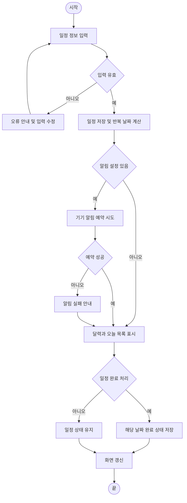

# 자취 생활 관리 달력 앱 설계 문서 V1

혼자 사는 사람을 위한 납부일·집안일·식재료 일정 관리

작성일 2026년 10월 29일 | 개인 프로젝트 초안

| 항목 | 내용 |
| --- | --- |
| 프로젝트명 | 혼자살림 (가칭) |
| 개발 형태 | 개인 프로젝트 프로토타입 |
| 가주제 한 줄 요약 | 자취 생활의 납부일, 반복 집안일, 식재료 유통기한을 한 달력에서 관리하는 앱 |
| 개발 기간 | 4주 계획안; 실제 일정과 플랫폼은 구현 전 확정 |

## 문서의 기준과 확정할 사항

본 문서는 현재 대화에서 정리한 프로젝트 방향을 바탕으로 한 목표 설계이며, 구현 완료 보고가 아니다. 핵심 사용 경험은 생활 일정 등록 → 달력/오늘 목록 확인 → 알림 수신 → 완료 표시로 설정한다.

첫 버전은 단일 사용자의 기기 내 저장을 기준으로 한다. 앱 플랫폼, 알림 구현 방식, UI 디자인은 미확정이다. 사용자 인터뷰와 기술 선택 후 조정한다.

식재료 관리는 우선 품목명과 날짜를 직접 입력하는 일정 기능으로 다룬다. 재고 관리·식단 추천·금융 연동은 핵심 사용 흐름이 검증된 뒤 검토한다.

## 설계에 사용하는 자료

| 자료 | 용도 |
| --- | --- |
| 대화에서 합의한 프로젝트 방향 | 납부일·집안일·유통기한 통합 달력이라는 문제와 MVP 범위의 근거 |
| 프로젝트 폴더의 설계 문서 양식 | 문제 정의 6요소, 모듈 분해, IPO, 의사코드, 흐름도, 테스트 명세, 제안서의 문서 구조 참고 |

본 문서에는 외부 사용자 인터뷰나 실제 구현 결과가 포함되어 있지 않다. 예시 일정과 테스트 입력은 가상 데이터다.

## 파트 1. 문제 정의서 (6요소)

아래 성공 기준은 초기 목표안이다. 소규모 테스트 결과로 방향을 조정하며, 실제 생활에서 일정 누락이 감소했는지는 장기 사용 평가가 필요하다.

| 요소 | 답해야 할 질문 / 작성 안내 | 프로젝트 작성란 |
| --- | --- | --- |
| ① 배경·문제 | 해결할 불편 | 자취 생활의 납부일, 분리수거·청소·세탁 같은 반복 집안일, 식재료 유통기한이 메모·알람·달력에 나뉘거나 기억에 의존한다. 사용자가 한곳에서 일정을 등록하고 놓치지 않도록 돕는다. 문제 빈도와 현재 해결 방식은 자취생 인터뷰로 검증한다. |
| ② 사용자 | 1차 및 2차 사용자 | 1차 사용자는 혼자 살며 생활비 납부와 집안일을 직접 챙기는 대학생·사회초년생이다. MVP는 단일 사용자 사용을 가정한다. 2차 사용자나 공동 관리 기능은 이번 범위에 두지 않는다. |
| ③ 입력 | 형식과 출처 | 사용자 입력: 일정 제목, 유형(납부/집안일/식재료), 날짜, 반복 종류(없음/매주/매월), 선택적 반복 종료일, 선택적 알림 시점. 앱은 날짜 및 반복 설정으로 달력 발생 건을 계산한다. 외부 계정 데이터는 입력받지 않는다. |
| ④ 출력 | 사용자 결과 | 월간 달력에 일정 날짜 표시, 선택 날짜의 일정 목록, 오늘의 미완료 일정, 기기 알림, 완료/미완료 상태를 제공한다. 알림 권한이 없거나 알림을 설정하지 않은 경우에도 앱 화면에서 일정은 확인할 수 있다. |
| ⑤ 성공 기준 | 측정 가능한 완료 조건 | ① 핵심 사용자 시나리오 5개(등록, 반복 등록, 날짜 확인, 알림 확인, 완료 처리)를 테스트 사용자 5명 중 4명 이상이 도움 없이 완료한다. ② 5명 중 4명 이상이 기존 방식보다 일정 확인이 편해질 것이라고 5점 척도에서 4점 이상 응답한다. ③ 반복 일정 생성·완료 처리·앱 재실행 후 데이터 유지 시나리오에서 오류 0건을 목표로 한다. 이는 초기 소규모 사용성 목표다. |
| ⑥ 범위 포함과 제외 | 이번 버전의 경계 | 포함: 일정 등록·수정·삭제, 유형, 월간 달력, 오늘 목록, 매주/매월 반복, 기기 알림, 날짜별 완료 처리, 로컬 저장. 제외: 계좌·카드 연동, 자동 가계부, 식단·레시피 추천, 바코드/OCR 인식, 공동 가구원 기능, 서버 계정·다중 기기 동기화, 소셜·랭킹 기능. |

## 파트 2. 모듈 분해도

### (1) 시스템 수준 IPO

| Input (입력) | Processing (처리) | Output (출력) |
| --- | --- | --- |
| 일정 제목·유형·날짜·반복 설정·알림 설정·완료 조작 | 입력 검증 → 일정 저장 → 반복 날짜 계산 → 오늘/달력 조회 → 알림 예약 → 완료 상태 갱신 | 달력 및 오늘 일정 목록, 기기 알림, 날짜별 완료 상태 |

### (2) 모듈 트리 (시스템 → 모듈 → 함수)

아래는 목표 구조다. 구현 플랫폼에 따라 파일·함수 경계는 달라질 수 있다.

```text
solo_calendar/
├── events.py
│   ├── validate_event(event)
│   ├── create_event(event, store)
│   ├── update_event(event_id, changes, store)
│   └── delete_event(event_id, scope, store)
├── recurrence.py
│   └── expand_occurrences(event, start_date, end_date)
├── calendar_view.py
│   ├── get_events_for_date(date, events)
│   └── get_month_view(year, month, events)
├── completion.py
│   └── set_occurrence_status(event_id, date, completed, store)
├── reminders.py
│   └── schedule_reminder(event, occurrence_date, platform)
└── storage.py
    ├── load_events(store)
    └── save_events(events, store)
```

### (3) 함수 목록

| 함수명 | 책임 (한 문장) | 입력 | 출력 | 외부 의존 |
| --- | --- | --- | --- | --- |
| validate_event | 일정 필드와 값의 유효성을 검사한다. | event: dict | 검증 결과 또는 오류 | 아니오 |
| create_event | 유효한 일정에 고유 ID를 부여해 저장한다. | event, store | 저장된 일정 | 아니오 |
| update_event | 지정한 일정의 허용된 필드를 수정하고 저장한다. | event_id, changes, store | 수정된 일정 | 아니오 |
| delete_event | 일정 전체 또는 선택한 반복 발생 건을 삭제한다. | event_id, scope, store | 삭제 결과 | 아니오 |
| expand_occurrences | 반복 규칙을 기간 내 날짜별 일정 발생 건으로 계산한다. | event, start_date, end_date | list[dict] | 아니오 |
| get_events_for_date | 지정 날짜의 일정 발생 건을 조회한다. | date, events | list[dict] | 아니오 |
| get_month_view | 월간 달력에 표시할 날짜별 일정 목록을 만든다. | year, month, events | dict[date, list] | 아니오 |
| set_occurrence_status | 반복 일정의 특정 날짜 발생 건 완료 상태를 저장한다. | event_id, date, completed, store | 갱신 결과 | 아니오 |
| schedule_reminder | 플랫폼 알림 기능에 일정 알림을 예약한다. | event, occurrence_date, platform | 예약 결과 | 기기 알림 API |
| load_events | 저장소에서 일정 목록을 읽는다. | store | list[dict] | 로컬 저장소 |
| save_events | 일정 목록을 저장소에 기록한다. | events, store | 저장 결과 | 로컬 저장소 |

## 파트 3. Pseudocode & Flowchart

아래 의사코드는 목표 동작 계약이다. 잘못된 입력이나 저장소 오류는 명시적 오류로 처리한다. 알림 예약 실패는 일정 저장 자체를 취소하지 않고 예약 실패 상태를 반환해 사용자에게 안내한다.

### 함수 1: validate_event

```text
FUNCTION validate_event(event) → dict
IF event가 dict가 아님: RAISE ValueError
IF title, type, date 중 필수 필드가 없음: RAISE ValueError
IF STRIP(title)이 빈 문자열: RAISE ValueError
IF type이 bill, chore, food 중 하나가 아님: RAISE ValueError
IF date가 유효한 날짜 형식이 아님: RAISE ValueError
IF recurrence가 none, weekly, monthly 중 하나가 아님: RAISE ValueError
IF recurrence가 none이 아닌데 종료일이 기준 날짜보다 앞섬: RAISE ValueError
RETURN {valid: true, errors: []}
```

### 함수 2: expand_occurrences

```text
FUNCTION expand_occurrences(event, start_date, end_date) → list[dict]
IF event 또는 날짜 범위가 올바르지 않음: RAISE ValueError
IF start_date > end_date: RAISE ValueError
SET result = []
IF event.recurrence == none:
    IF event.date가 start_date와 end_date 사이임: APPEND event 발생 건 to result
    RETURN result
SET cursor = event.date
WHILE cursor <= end_date AND (종료일이 없거나 cursor <= 종료일):
    IF cursor >= start_date: APPEND {event_id, date: cursor} to result
    IF recurrence == weekly: cursor를 7일 뒤로 이동
    IF recurrence == monthly: 다음 달 같은 일자로 이동
    IF 다음 달에 같은 날짜가 없으면 그 달의 마지막 날로 이동
RETURN result
```

### 함수 3: set_occurrence_status

```text
FUNCTION set_occurrence_status(event_id, date, completed, store) → dict
IF event_id가 문자열이 아니거나 date가 유효한 날짜가 아님: RAISE ValueError
IF completed가 boolean이 아님: RAISE ValueError
SET event = store에서 event_id 조회
IF event가 없음: RAISE ValueError
IF date가 event의 실제 발생 날짜가 아님: RAISE ValueError
TRY:
    해당 event_id와 date 조합의 완료 상태를 completed로 저장
    RETURN {updated: true, event_id, date, completed}
CATCH 저장 오류:
    RETURN {updated: false, reason: storage_error}
```

### 전체 일정 관리 Flowchart

새 일정 등록부터 날짜별 완료 처리까지의 MVP 핵심 경로다. 알림 예약에 실패해도 일정 화면 사용은 계속할 수 있다.



## 파트 4. 테스트 케이스 명세표

테스트 일정 E1은 매주 화요일 분리수거 일정이고, E2는 2026-10-31 우유 유통기한 일정인 가상 데이터다. 아래는 테스트 명세이며 실행 결과가 아니다.

| ID | 대상 함수 | 범주 | 입력 | 기대 출력 / 동작 |
| --- | --- | --- | --- | --- |
| T01 | validate_event | 정상 | 제목 관리비, type=bill, date=2026-11-25, recurrence=monthly | valid=true |
| T02 | validate_event | 정상 | 제목 분리수거, type=chore, date=2026-10-27, recurrence=weekly | valid=true |
| T03 | validate_event | 경계 | title가 공백 문자열 | ValueError, 빈 제목 안내 |
| T04 | validate_event | 예외 | type=payment 등 허용 목록에 없는 값 | ValueError |
| T05 | expand_occurrences | 정상 | 매주 화요일 E1, 조회기간 2026-10-26~2026-11-15 | 기간 내 화요일 발생 건 반환 |
| T06 | expand_occurrences | 정상 | 매월 31일 일정, 2026년 11월 조회 | 2026-11-30에 발생 건 반환 |
| T07 | expand_occurrences | 경계 | recurrence=none, 조회기간에 기준 날짜 없음 | 빈 목록 반환 |
| T08 | expand_occurrences | 예외 | start_date가 end_date보다 늦음 | ValueError |
| T09 | set_occurrence_status | 정상 | E1의 실제 발생 날짜에 completed=true | 해당 날짜 상태만 true로 저장 |
| T10 | set_occurrence_status | 정상 | 이미 완료된 E1 발생 건에 completed=false | 해당 날짜 상태가 false로 변경 |
| T11 | set_occurrence_status | 경계 | 존재하는 일정이지만 그 일정의 발생 날짜가 아닌 날짜 | ValueError, 상태 변경 없음 |
| T12 | set_occurrence_status | 예외 | event_id가 저장소에 없음 | ValueError |

추가 확인: 알림 권한 거부 시 일정은 저장되고 앱 내 목록에 나타나야 한다. 알림 예약 오류가 일정 저장을 롤백하지 않는지 확인한다. 반복 일정의 특정 날짜 완료 처리로 다른 날짜의 상태가 바뀌지 않아야 한다.

## 파트 5. 캡스톤 가주제 제안서

**(1) 가주제 한 줄 요약**  납부일·반복 집안일·식재료 날짜를 한곳에서 관리하는 자취 생활 달력 앱

**(2) 카탈로그와의 관계**  현재 수업 카탈로그 정보는 제공되지 않아 주제 분류 및 유사 과제 여부는 별도 확인이 필요하다. 본 문서는 개인 프로젝트 아이디어 초안이다.

### (3) 외부 서비스 활용 지점과 Mock 계획

핵심 MVP의 일정 등록·반복 계산·달력 조회·완료 상태는 외부 AI 서비스 없이 구현한다. 기기 알림은 플랫폼 알림 API에 연결하되, 개발 초기에는 예약 결과를 반환하는 mock adapter로 성공·권한 거부·예약 실패 흐름을 재현한다.

실제 알림 연결 후에도 동일한 입력/출력 계약을 유지한다. 알림이 실패해도 일정 저장과 앱 내 확인은 정상 작동해야 한다. LLM은 MVP 필수 요소가 아니며, 식단 추천 등 AI 기능은 이번 설계 범위에 포함하지 않는다.

### (4) 역할 분담 제안

개인 프로젝트이므로 현재는 역할 분담 대상이 확정되지 않았다. 팀 프로젝트로 전환할 경우 아래 역할을 나눌 수 있다.

| 역할 | 담당 모듈 / 작업 | 비고 |
| --- | --- | --- |
| 앱 화면 | 오늘·달력·일정 입력 화면 | 사용자 흐름과 접근성 확인 |
| 일정 도메인 | 검증, 반복 계산, 날짜별 완료 처리 | 경계 날짜 규칙 관리 |
| 저장·알림 | 로컬 저장소 및 기기 알림 연결 | 권한 거부·실패 경로 포함 |
| 사용자 검증 | 인터뷰, 사용성 관찰, 피드백 정리 | 실제 문제 빈도와 우선순위 검증 |

### (5) 상호 리뷰 반영 기록

아직 외부 리뷰 의견은 제공되지 않았다. 아래 항목은 리뷰에서 확인할 질문이며, 실제 리뷰 결과를 의미하지 않는다.

| 리뷰 확인 질문 | 반영/기각 | 사유 또는 후속 조치 |
| --- | --- | --- |
| 자취생이 가장 자주 놓치는 일정 유형은 무엇인가 | 리뷰 대기 | 인터뷰 결과에 따라 MVP의 일정 유형 우선순위 조정 |
| 기존 달력/알람과 비교해 별도 앱을 쓸 이유가 분명한가 | 리뷰 대기 | 등록부터 완료까지의 흐름과 자취 특화 가치 검증 |
| 매월 29~31일 반복 규칙이 이해하기 쉬운가 | 설계 반영, 사용자 검증 대기 | 해당 월 마지막 날로 처리하는 규칙을 안내하고 사용성 테스트 |
| 알림이 오지 않아도 앱에서 일정을 놓치지 않게 확인할 수 있는가 | 설계 반영 | 오늘 목록·달력 조회를 알림과 독립적으로 제공 |

## 제출 전 체크리스트

| 번호 | 확인 항목 | 확인 |
| --- | --- | --- |
| 1 | 성공 기준이 숫자 또는 판정 가능한 조건으로 서술되었다 | 설계 반영 |
| 2 | 이번 버전에서 제외할 기능이 3개 이상 있다 | 설계 반영 |
| 3 | 모든 함수에 한 문장 책임 설명이 붙어 있다 | 설계 반영 |
| 4 | 외부 의존 기능의 mock 대체 계획이 있다 | 설계 반영 |
| 5 | Pseudocode 3개에 예외 흐름이 포함되어 있다 | 설계 반영 |
| 6 | Flowchart의 판단 분기들이 후속 흐름과 합류한다 | 설계 반영 |
| 7 | 핵심 함수별 정상 2·경계 1·예외 1개 이상의 테스트 명세가 있다 | 설계 반영 |
| 8 | 리뷰 의견별 반영/기각과 사유가 기록되어 있다 | 리뷰 전 |
| 9 | 실제 구현 저장소와 제출 링크가 준비되어 있다 | 미완료 |

## 부록 A. 평가 루브릭 참고

| 평가 요소 | 적용 기준 |
| --- | --- |
| 문제 정의 | 사용자·불편·성공 조건이 구체적이고 검증 가능한가 |
| 기능 분해 | 함수 책임이 명확하고 일정·반복·알림 경계가 일관적인가 |
| 의사코드·흐름도 | 정상·경계·오류 흐름이 드러나고 판단 분기가 연결되는가 |
| 테스트 명세 | 정상·경계·예외와 월말 반복·알림 권한 실패가 포함되는가 |
| 사용자 검토 | 자취생 피드백을 실제로 반영하고 미검증 가정을 구분했는가 |

## 부록 B. 설계 규칙 요약

- 반복 일정의 완료 상태는 전체 일정이 아니라 날짜별 발생 건에 저장한다.
- 매월 29~31일 반복은 해당 월의 마지막 날짜로 보정한다.
- 알림 실패는 일정 저장 실패와 분리한다.
- 알림 권한을 허용하지 않아도 달력과 오늘 목록에서 일정 확인이 가능해야 한다.
- 유통기한 및 납부일 등 생활 정보는 필요한 최소 항목만 보관한다.
- 사용자 인터뷰와 실제 테스트가 끝나기 전에는 성공 기준을 달성했다고 표현하지 않는다.
